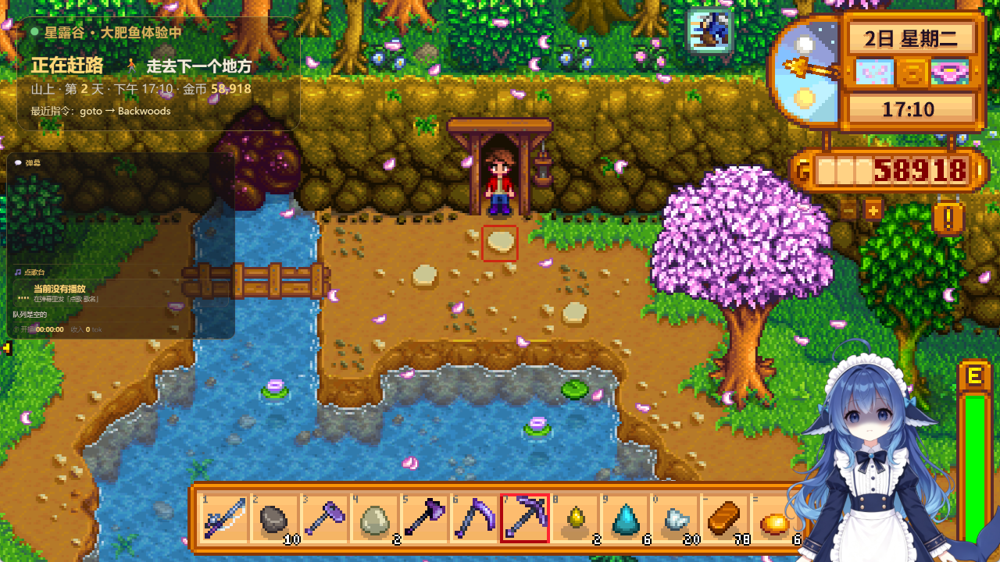
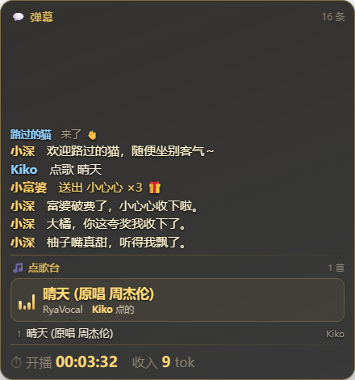

# 鲸live · DeepLive

> 开源 AI 虚拟主播直播控制台 —— 弹幕进来，DeepSeek 接话，TTS 出声，Live2D 动起来，OBS 一体出画。

一套完全自托管的直播方案：抖音弹幕 → DeepSeek 生成回复 → 本地 TTS 播报 → Live2D 皮套口型 →
OBS 网页叠层（弹幕 / 点歌 / 状态卡），不需要第三方 SaaS，核心服务只用 Node 标准库。



## 能做什么

| 能力 | 说明 |
|---|---|
| 💬 弹幕互动 | 抖音直播间弹幕/礼物/进场/关注实时接入，DeepSeek 生成人设化回复 |
| 🗣️ 本地语音 | GPT-SoVITS v2Pro 零样本 TTS，主播音色可换参考音；说话时皮套自动口型 |
| 🎵 点歌台 | 弹幕 `点歌 歌名` → 网易云/QQ 搜歌 → 播放原曲，队列/正在播放实时同步到叠层 |
| 🧍 Live2D 皮套 | pixi-live2d-display（Cubism 4），随机表情 + 呼吸/待机动作，透明网页源 |
| 🖥️ OBS 一键配置 | 自动建场景、布景、开源；横屏/竖屏自动判断，星露谷专用预设 |
| 🌾 星露谷 AI 直播 | WhalePlayer 模组 + Python agent，AI 自己种地/挖矿；状态卡实时显示在播内容 |
| 📊 数据面板 | 开播时长、礼物抖币收入、token 消耗，`/api/metrics` 可查 |
| 🖥️ 双形态 | Electron 桌面控制台，或纯 Node 网页版（`node server/index.cjs`） |

| 弹幕 + 点歌面板 | 星露谷状态卡 |
|---|---|
|  |  |

## 技术栈

`Node.js 标准库`（HTTP/WS/进程管理）· `Vue 3 + Vite`（控制台）· `Electron`（桌面壳）·
`GPT-SoVITS`（TTS）· `pixi.js + Cubism 4`（皮套）· `obs-websocket`（OBS 控制）·
`DeepSeek API / Ollama`（对话）

## 目录结构

```
app/main/core.cjs      核心服务（零 npm 依赖）
app/main/ipc.cjs       IPC 通道表
electron/main.cjs      Electron 主进程（起服务 + 开窗口）
electron/preload.cjs   渲染层 API（window.whale.invoke）
src/                   Vue 3 控制台（Vite 构建）
public/                免构建页面：console/dashboard/live2d/overlay/songs
server/index.cjs       纯 Node 启动入口（无 Electron）
extras/python/         可选增强脚本（清唱音频管线 sing_tts.py/点歌/合成/游戏画面等）
```

## 快速开始

```bash
git clone https://github.com/a106832411/deepseek-live.git
cd deepseek-live
copy config.example.json config.json      # Linux/macOS: cp
```

编辑 `config.json` 填三项：

1. `ai.openai_key` —— DeepSeek API Key（https://platform.deepseek.com）
2. `tts.ref_audio` / `tts.prompt_text` —— GPT-SoVITS 参考音频路径与对应文字（本机需跑 TTS 服务）
3. `douyin.web_rid` —— 抖音直播间号

启动：

```bash
node server/index.cjs --port 8788     # 纯服务
npm install && npm run electron        # 桌面控制台（自动起 8788 + IPC）
```

## 环境变量（.env）

推荐用 `.env` 管密钥，不要写进 `config.json`：

```bash
copy .env.example .env      # Linux/macOS: cp
```

常用变量：

| 变量 | 说明 |
|---|---|
| `DEEPLIVE_PORT` | 服务端口，默认 8788 |
| `DEEPLIVE_AI_BASE` / `DEEPLIVE_AI_MODEL` / `DEEPLIVE_AI_KEY` | DeepSeek 接口、模型、Key |
| `DEEPLIVE_AI_MAX_CHARS` / `DEEPLIVE_AI_TEMPERATURE` | 回复字数上限、温度 |
| `DEEPLIVE_PERSONA` | 主播人设（system prompt），换行写 `\n` |
| `DEEPLIVE_TTS_URL` | TTS 代理地址（默认 127.0.0.1:9881） |
| `DEEPLIVE_TTS_REF_AUDIO` / `DEEPLIVE_TTS_PROMPT_TEXT` | 参考音频路径与对应文字 |
| `DEEPLIVE_TTS_SPEED` / `_STEPS` / `_TOP_K` / `_TEMPERATURE` | 合成参数 |
| `DEEPLIVE_DOUYIN_MODE` / `DEEPLIVE_DOUYIN_RID` | 抖音接入方式（relay/browser）与房间号 |
| `DEEPLIVE_SONGS_ENABLED` / `_SOURCES` / `_MAX_QUEUE` | 点歌/清唱开关、音源顺序（play 模式）、队列长度 |
| `DEEPLIVE_SONGS_PERFORM` | 唱歌方式：`sing` 清唱（默认）/ `play` 播放原曲（旧行为） |
| `DEEPLIVE_SING_ENABLED` / `_MODE` / `_LYRICS` | 清唱开关、唱法 `melody`（带旋律）/`read`（纯念唱）、歌词来源 `netease`（抓原词）/`ai`（AI 现编） |
| `DEEPLIVE_SING_MAX_LINES` / `_MAX_CHARS` | 每首唱几句（默认 6）、整首歌词字数上限（默认 100） |
| `DEEPLIVE_SING_INTRO` / `_OUTRO` / `_FILLER` | 开唱报幕 / 唱完道谢 / 合成等待时的垫话（`false` 可关） |
| `DEEPLIVE_SING_MELODY` / `_BPM` / `_VIBRATO` / `_GAP_MS` | 旋律（auto/xiaoxingxing/shengri/folk1/folk2）、节拍、颤音、句间停顿 |
| `DEEPLIVE_OBS_HOST` / `_PORT` / `_PASSWORD` | OBS WebSocket 地址（默认 4455）与密码 |
| `DEEPLIVE_OBS_SCENE` / `_BG` | 自动创建的场景名、背景色（hex） |
| `DEEPLIVE_MERGE_WINDOW` | 同用户事件合并窗口（秒） |
| `DEEPLIVE_FILTER_BLOCKLIST` | 弹幕过滤词，逗号分隔 |

优先级：**真实环境变量 > `.env` > `config.json` > 内置默认值**。

> 注意：清唱参数如果在 `.env` 里写了（如 `DEEPLIVE_SING_FILLER`），会覆盖 `config.json`/控制台里改的值。

## 点歌（默认播放原曲）

当前默认 `songs.perform=play`：弹幕点歌**播放原曲**（不合成、无版权风险），点歌台显示正在播放与队列。
清唱（sing）模式仍保留代码，但真唱/合成音色实验已暂停，切回方式见下。

```bash
# 弹幕里发（全角斜杠/冒号/书名号都兼容）
唱歌                 # 不带歌名：从 sing.pick_list 随机
唱歌 稻香            # 「唱歌/唱一首/来一首」类需要空格或冒号分隔歌名
清唱 晴天
点歌 七里香
/点歌 宁夏
跳过                 # 跳过当前清唱 / 排队中的下一首
```

- 需要本地 **GPT-SoVITS TTS**（见下文「依赖服务」）；参考音配 `DEEPLIVE_TTS_REF_AUDIO`。
- 控制台「清唱队列」看当前/排队，「配置 → 🎤 清唱」改唱法（melody/read）、歌词来源、句数、BPM、垫话等。
- 想回到旧行为（播原曲）：`.env` 里 `DEEPLIVE_SONGS_PERFORM=play` 或控制台「表演模式 → 播放原曲」，
  旧接口/旧状态形状都保留。
- 清唱引擎代码保留在 `extras/python/sing_tts.py`；真唱/合成音色实验已暂停，相关细节见历史提交。

## 地址

| 地址 | 用途 |
|---|---|
| `/console` | 完整控制台（网页版） |
| `/live2d` | Live2D 皮套（OBS 浏览器源，透明） |
| `/overlay` | 弹幕层（OBS 浏览器源） |
| `/songs` | 点歌/清唱列表（旧版独立面板） |
| `/subtitle` | 清唱歌词字幕条（OBS 浏览器源） |
| `/ov_stardew` | 星露谷状态卡（OBS 浏览器源，配 8790 状态服务） |
| `/ov_panel` | 弹幕 + 点歌 + 开播时长/收入 合并面板（OBS 浏览器源） |
| `127.0.0.1:8790` | 星露谷状态服务（`/api/stardew`、`/stardew`） |
| `/dashboard` | 精简控制台 |

## 星露谷 AI（本地模型）

AI 玩星露谷走**本机模型、0 token**；鲸live 的直播回复仍走 DeepSeek，两套互不影响：

```
鲸live 直播回复  → DeepSeek（云端，$DEEPLIVE_AI_*）
星露谷 AI        → Ollama qwen25-7b-local（本机，$STARDEW_LLM_*）
```

```powershell
python extras/python/stardew_agent.py --dry          # 只出计划
python extras/python/stardew_agent.py --once         # 执行一轮
python extras/python/stardew_agent.py --loop         # 循环
```

架构、能力和限制见 [docs/星露谷AI.md](docs/星露谷AI.md)。

## 本地模型（省钱模式）

不想按 token 付费，可以用本机 Ollama 跑 7B 模型，token 成本归零：

```ini
DEEPLIVE_AI_BASE=http://127.0.0.1:11434/v1
DEEPLIVE_AI_MODEL=qwen2.5:7b
DEEPLIVE_AI_KEY=ollama
```

详细步骤（模型下载、测速、常见问题）见 [docs/本地模型.md](docs/本地模型.md)。

## OBS 一键配置

控制台「形象与画面 → OBS 一键配置」，或直接调接口：

```bash
curl -X POST http://127.0.0.1:8788/api/obs/probe   -d '{}'   # 连接测试
curl -X POST http://127.0.0.1:8788/api/obs/setup   -d '{}'   # 一键建场景
```

会自动在 OBS 里：

1. 创建/复用场景（默认名 `鲸live`，可配置）
2. 加背景色层（默认 `#0b0c0e`）
3. 加 3 个浏览器源并按画布自动摆位（横屏/竖屏自动判断）：
   - 皮套 `/live2d?scale=0.95`
   - 弹幕层 `/overlay`
   - 清唱列表 `/songs`（需要歌词字幕可再加一个 `/subtitle`）
4. 切到该场景

星露谷直播用另一个预设（`DEEPLIVE_OBS_PRESET=stardew`，场景 `星露谷直播`）：

| 源 | 地址 | 默认位置/尺寸 |
|---|---|---|
| 游戏画面 | 窗口采集 `Stardew Valley` | 全屏 |
| 星露谷状态 | `/stardew`（1180×220 可调，`body{zoom:1.45}`） | (32,32) |
| 弹幕+点歌 | `/ov_panel` | 左上/左下，按需调整 |
| 皮套 | `/live2d?zoom=1.75&dy=500` | 右下 |

状态数据由 `extras/python/status_server.py`（8790）提供，读 `WhalePlayer/player_state.json`
与 `logs/ai_status.json`（最近指令）；token 统计见 `GET /api/metrics`。

需要在 OBS 里开启：**工具 → WebSocket 服务器设置 → 启用**，把端口/密码填进 `.env` 或控制台。

## 主要 API

| 方法 | 路径 | 说明 |
|---|---|---|
| POST | `/api/session/start` `/api/session/stop` | 开始/结束会话 |
| POST | `/api/douyin/ingest` | 弹幕中继投递（外部脚本 → 服务） |
| POST | `/api/say` | 手动让主播说话（走 TTS） |
| GET/POST | `/api/config` | 读/改配置（即时生效） |
| POST | `/api/test_event` | 注入测试事件 |
| GET | `/api/songs/state` | 清唱状态 `{mode:'sing', sing{enabled,style,lyrics}, current{lyrics,lyricIndex,audio,duration}, queue}`（`perform=play` 时返回旧形状） |
| POST | `/api/songs/request` | 点歌/清唱 `{name, query}`；返回 `{ok, position, song}` |
| POST | `/api/songs/skip` | 跳过（正在唱→打断；排队→删队首；查歌词窗口→3 秒内取消；空闲→无操作），见 `app/main/core.cjs` 点歌逻辑 |
| GET | `/api/deps` | 运行环境探测：TTS / OBS / Ollama / Python / 真唱引擎是否在线，见 [docs/运行环境.md](docs/运行环境.md) |
| POST | `/api/deps/start` `/api/deps/stop` | 一键启动 / 停止依赖服务（只停鲸live 自己启动的） |
| POST | `/api/douyin/heartbeat` | 弹幕中继心跳（判断中继死活；内置中继每 15 秒上报） |
| GET | `/api/live2d/models` | 皮套模型列表 + 当前模型 |
| POST | `/api/live2d/model` | 切换皮套模型（写回 `live2d.model`） |
| WS | `/ws` | 事件/回复/日志/状态推送；清唱事件 `sing start/line/end`、`song queued` |

## 桌面版特性

- 左侧菜单树控制台（会话 / 事件 / 配置 / 皮套 / 叠加层 / 清唱队列 / 说话 / 运行环境）
- 全部配置表单化（AI、TTS、事件触发、固定回复、过滤词、清唱/点歌、运行环境启动命令），也支持高级 JSON 编辑
- **运行环境页**：TTS / 抖音中继 / OBS / Ollama / Python / 真唱引擎状态灯 + 一键启动，
  启动方式自动发现本机路径（见 [docs/运行环境.md](docs/运行环境.md)）
- **抖音中继内置**：`extras/douyin/relay.js`（Node 零依赖 + Chrome CDP 读聊天 DOM），
  一键启动/停止，见 [docs/抖音接入.md](docs/抖音接入.md)
- **皮套模型管理**：模型丢进 `public/live2d/models/<名字>/`，控制台下拉切换，OBS 源 URL 不用改
- **统一控制台**：浏览器打开 `/console` 和 Electron 窗口是同一套 Vue 控制台（自动回退 HTTP API）
- 端口 8788 被占用时核心自动 +1 顺延，Electron 等真正监听成功再开窗口，不会白屏
- 黑金主题，可二次开发换肤

## 打包成 exe

```bash
npm run build:exe        # 便携版：release\鲸live-<版本>-portable.exe
npm run build:installer  # NSIS 安装包（per-user，免管理员）
```

打包后是 `app.asar`，运行期可写目录（logs / config.json / .env）走
`WT_DATA` → `PORTABLE_EXECUTABLE_DIR`（便携版 = exe 同目录）→ 安装版 userData；
Python 脚本（清唱）从 `resources\app.asar.unpacked\extras\python` 起。详见 [docs/打包.md](docs/打包.md)。

## 依赖服务

| 服务 | 用途 |
|---|---|
| DeepSeek API | AI 回复 |
| GPT-SoVITS（清唱必需） | 语音克隆 TTS（9881 代理 → 9882）：说话和清唱都用它；TTS 不通时清唱会退化成逐句念唱/无声，但不会卡队列 |
| OBS Studio（可选） | 直播推流与叠加层合成 |
| 抖音中继脚本（可选） | 弹幕采集后 POST 到 `/api/douyin/ingest` |

## 许可

MIT
